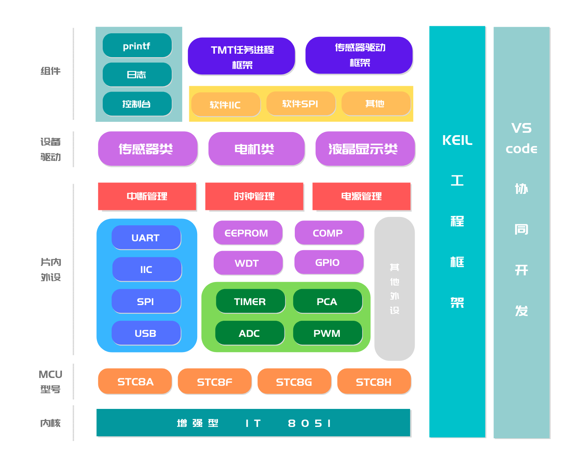

# MCS51-ELL

[English](README.md) | [简体中文](README.zh-CN.md)

MCS51-ELL is a hardware abstraction platform for MCUs built around enhanced 8051 cores. It is developed for Keil and provides a collection of standard APIs for accessing low-level hardware while keeping code size and execution efficiency balanced. ELL can be configured and trimmed to fit the needs of a project.

ELL stands for `efficient low-layer`. It combines the ideas of HAL and LL libraries: keeping APIs reusable while avoiding unnecessary flash usage. The result is a library that is efficient, compact, and easy to use.

MCS51-ELL supports Keil 4, Keil 5, and collaborative development with Visual Studio Code. The EIDE extension is recommended. The library currently focuses on STC MCUs, especially the STC8 series, with STC12, STC15, and STC16 planned for future support.

The library is licensed under the Apache License 2.0. It can be used in commercial products free of charge, without requiring the application source code to be published.

If you find it useful, please give the project a `Star`!

---

Current version: `1.1.6.0725`

Bilibili: `zevorn`

QQ support group: `1001220381`

---

## Getting Started

[Watch the Bilibili tutorial](https://www.bilibili.com/video/BV1i54y1J7Ap)

ELL uses a bare-metal framework to organize its files. The framework consists of two main parts: `project files` and `library files`.

Project files contain Keil projects, Visual Studio Code files, and user code. You can arrange them freely according to your development workflow. The library files are divided into four areas: `core`, `on-chip peripherals`, `components`, and `device drivers`. Components and device drivers are developed separately and are not included in this repository.

### Repository layout

| Top-level directory | Subdirectory | Description |
| :---: | :---: | :--- |
| `doc` | ... | Documentation and reference material |
| `examples` | --- | Example code |
|  | `STC8Ax` | Examples for the STC8A series |
|  | `STC8Cx` | Examples for the STC8C series |
|  | `...` | Examples for other MCU families |
| `libraries` | --- | ELL library files |
|  | `core` | Registers and startup files |
|  | `peripherals` | On-chip peripheral libraries |
| `project` | --- | Template projects |
|  | `STC8Ax` | Template projects for the STC8A series |
|  | `STC8Cx` | Template projects for the STC8C series |
|  | `...` | Template projects for other MCU families |

ELL's framework is illustrated below:



The library also makes use of Keil features such as the LX51 extended linker/locator, which improves on BL51 and can produce smaller target files.

# Source Code Guide

## 1. Basic Architecture

At the architectural level, ELL consists of three parts: the on-chip peripheral library, the component library, and the device driver library. The on-chip peripheral library is the core of ELL and contains drivers for MCU peripherals. Components and device drivers are open for developers to implement their own drivers or port software packages.

The repository is organized into the `libraries` and `project` directories.

The `libraries` directory contains `startup`, `core`, and `peripherals`. `startup` contains assembly startup code. `core` contains MCU register definitions and ELL core data types, and also manages MCU interrupts such as interrupt numbers. The remaining library directories follow the architecture described above.

The `project` directory contains Keil C51 projects. IAR and SDCC support may be added later. A project generally contains `main`, `application`, and `build` directories: `main` stores system initialization and interrupt service routines, `application` stores application code, and `build` stores generated binaries and assembly files.

## 2. Data Structures

ELL uses object-oriented encapsulation ideas while making adjustments for the resource and performance constraints of 8051 MCUs. For peripherals with multiple related operating modes, it uses structures and enumerations. For individual or more abstract peripherals, it uses function parameters, with parameters still represented by enumerations or consistently defined macros.

In structure-and-enumeration based interfaces, an enumeration member usually configures one feature or parameter, while the structure containing those members represents the complete state of a peripheral.

ELL also makes extensive use of macros, including function-like macros, control macros, and configurable macro parameters. Function-like macros encapsulate register operations to improve readability without sacrificing execution efficiency. Control macros trim ELL features and provide configuration options.

# Supported MCUs and Peripherals

> `√` means supported, a blank cell means the MCU does not have the peripheral, and `X` means the peripheral has not been adapted yet.

### STC8 series

Some details may vary between models. Refer to the official datasheets for the exact capabilities of each MCU.

| MCU | Timers | GPIO | Interrupts | System clock | PCA | PWM | MPWM | HPWM | EEPROM | ADC | MDU16 | Comparator | USB | LED | RTC | TKEY |
| --- | --- | --- | --- | --- | --- | --- | --- | --- | --- | --- | --- | --- | --- | --- | --- | --- |
| STC8A series | √ | √ | √ | √ | √ | √ | X | X | √ | √ |  | √ |  |  |  |  |
| STC8C series | √ | √ | √ | √ |  |  |  |  | √ |  | √ | √ |  |  |  |  |
| STC8F series | √ | √ | √ | √ |  |  |  |  | √ |  |  | √ |  |  |  |  |
| STC8G series | √ | √ | √ | √ | √ |  | √ |  | √ | √ | √ | √ | X | X |  |  |
| STC8H series | √ | √ | √ | √ |  |  |  | X | √ | √ | √ | √ | X | X | X | X |

# Contributing

## 1. Coding Conventions

1. Macro names use uppercase letters throughout.

```c
// Function-like macro:
#define NVIC_COMP_CTRL(run) do { CMPCR1 = (CMPCR1 & 0xCF) | (run << 4); } while (0)

// Regular macro:
#define PER_LIB_COMP_CTRL 1
```

2. Variable names use verb-object order. Long words should be abbreviated to three letters, and words are separated with `_`.

Global variables use the `G_` prefix. Local variables start with a lowercase letter.

```c
// Global variable:
uint8_t G_Uart_Busy_Flg = 0; // Busy flag of receive

// Local variable:
uint32_t sysClk_FRE;
```

3. Function names use a name-plus-action form. The first letter of each word is uppercase and words are separated with `_`. Function parameters start with a lowercase letter.

```c
FSCSTATE MPWMn_Port_Init(MPWMPort_Type port, MPWMCLKSrc_Type clkSrc, uint16_t period)
{
    ...
}
```

4. Use the Doxygen format for code comments. See the library source code for more details.

```c
/**
 * @brief     Initialize a PWM port.
 * @details   Initialize the specified PWM port (0 to 5).
 * @param[in] port PWM port enumerator.
 * @param[in] clkSrc PWM clock source.
 * @param[in] period PWM period value (counter reload value).
 * @return    FSC_SUCCESS on success.
 * @return    FSC_FAIL on failure.
 */
```

5. ELL uses code comments to divide C and H files into standard regions, making source management more consistent.

```c
/*-----------------------------------------------------------------------
|                            FILE DESCRIPTION                           |
-----------------------------------------------------------------------*/
/*----------------------------------------------------------------------
  - File name     : xxx.c
  - Author        : zeweni
  - Update date   : 2020.01.11
  - Copyright(C)  : 2020-2021 zeweni. All rights reserved.
----------------------------------------------------------------------*/
/*------------------------------------------------------------------------
|                            COPYRIGHT NOTICE                            |
------------------------------------------------------------------------*/
/*
 * Copyright (C) 2021, zeweni (17870070675@163.com)
 *
 * This file is part of 8051 ELL low-layer libraries.
 *
 * 8051 ELL low-layer libraries is free software: you can redistribute
 * it and/or modify it under the terms of the Apache-2.0 License.
 */
/*-----------------------------------------------------------------------
|                               INCLUDES                                |
-----------------------------------------------------------------------*/

/*-----------------------------------------------------------------------
|                                 DATA                                  |
-----------------------------------------------------------------------*/

/*-----------------------------------------------------------------------
|                               FUNCTION                                |
-----------------------------------------------------------------------*/

/*-----------------------------------------------------------------------
|                   END OF FILE. (C) COPYRIGHT zeweni                  |
-----------------------------------------------------------------------*/
```

## 2. Module Development Guide

ELL uses Git for source control, with Gitee as the primary repository and GitHub as a backup mirror. If you want to become an ELL contributor, use the Gitee repository as the primary development repository.

### 1. Fork the repository

Fork this repository to your own account and develop on top of your fork.

### 2. Develop your code

#### Registers

To keep a consistent style while retaining maximum flexibility, ELL development can go down to the register level. Register header files continue to use the official naming conventions for compatibility, while their implementation is organized by module. Register headers are stored under `libraries/core/register/<series>`.

#### Data structures

Refer to the source code guide above. The core approach is to combine structures, enumerations, and macros, with register operations encapsulated by macros.

#### API functions

Use any existing module as a reference when designing a new API.

### 3. Submit a pull request or issue

After completing your changes, open a pull request to request a merge and explain the change in detail in the issue tracker. After the administrator reviews the code, the pull request can be merged into the main repository.

# Community

You are welcome to join the group for help with learning and using the ELL library.

> 
